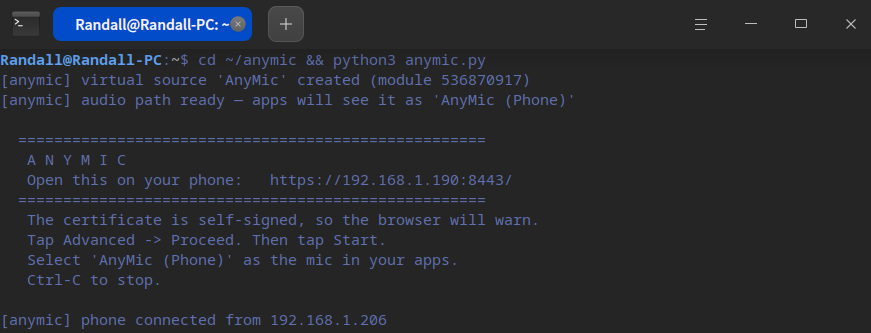
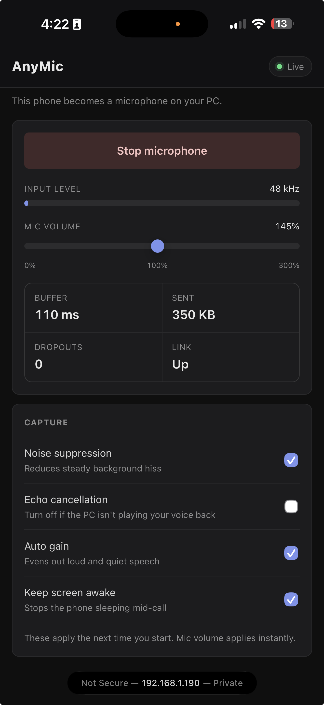

<div align="center">

# 🎙️ UniMic

### Turn any phone into a microphone. No phone app.

**Linux** · **Windows** · **macOS**

[](https://github.com/rndllb/UniMic/releases)
[](https://www.python.org/)
[](#-requirements)
[](LICENSE)

[](#-platforms-at-a-glance)
[](#-platforms-at-a-glance)
[](#-platforms-at-a-glance)
[](#-requirements)
[](#-requirements)

[🚀 Quick start](#-quick-start) ·
[🖥️ Platforms](#-platforms-at-a-glance) ·
[⚙️ Options](#options) ·
[🩺 Troubleshooting](#-troubleshooting) ·
[🔒 Security](#-security)

</div>

---

> [!TIP]
> **Just want it working?** Read [INSTRUCTIONS.txt](INSTRUCTIONS.txt). It's a plain step-by-step walkthrough for each platform. This README covers how it works and why.

## ✨ What it does

Your phone's browser captures the mic and streams raw audio over a secure WebSocket. A small Python server feeds that into a virtual audio device, so **any app** (Discord, OBS, Zoom, browsers) sees an ordinary microphone.


<table>
<tr>
<td width="25%" align="center">📵<br/><b>No phone app</b><br/><sub>Any modern browser</sub></td>
<td width="25%" align="center">📦<br/><b>No pip installs</b><br/><sub>Standard library only</sub></td>
<td width="25%" align="center">🔐<br/><b>Encrypted</b><br/><sub>TLS out of the box</sub></td>
<td width="25%" align="center">🔄<br/><b>Self-updating</b><br/><sub>Always asks first</sub></td>
</tr>
<tr>
<td align="center">🎚️<br/><b>Live volume</b><br/><sub>0–300% with clip meter</sub></td>
<td align="center">📶<br/><b>Jitter buffer</b><br/><sub>No robot voice</sub></td>
<td align="center">🔒<br/><b>One device at a time</b><br/><sub>No hijacking</sub></td>
<td align="center">🌐<br/><b>Any IP link</b><br/><sub>WiFi, USB, hotspot</sub></td>
</tr>
</table>

## 📸 What it looks like

<table>
<tr>
<th>💻 On the PC</th>
<th>📱 On the phone</th>
</tr>
<tr>
<td valign="top">

Start it. It sets up the virtual mic, prints the URL to open, and names the device to select in your apps.



</td>
<td valign="top" align="center">

Open the URL, tap **Start microphone**.



</td>
</tr>
</table>

## 🖥️ Platforms at a glance

The only thing that changes by platform is where the virtual device comes from.

| | 🐧 **Linux** | 🪟 **Windows** | 🍎 **macOS** |
|---|---|---|---|
| **Virtual mic** | UniMic creates a PipeWire virtual source itself | Plays into [VB-CABLE](https://vb-audio.com/Cable/), apps record its other end | Plays into [BlackHole](https://existential.audio/blackhole/), apps record the same device |
| **Install once** | ✅ Nothing | 📥 VB-CABLE | 📥 BlackHole |
| **Launcher** | `python3 unimic.py` | Double-click `unimic.bat` | Double-click `unimic.command` |
| **Pick in your app** | `UniMic (Phone)` | `CABLE Output` | `BlackHole 2ch` |

> [!NOTE]
> Linux is the only OS that can create a microphone from scratch. Windows and macOS need a driver for any capture device, so UniMic plays into a free virtual audio cable you install once and forget about. Everything above that layer (the page, the jitter buffer, the mic lock, TLS) is the same code on all three.

## 🚀 Quick start

<table>
<tr>
<td width="33%" valign="top">

### 1️⃣ Start the server

**Windows:** double-click `unimic.bat`
**macOS:** double-click `unimic.command`
**Linux:**
```bash
python3 unimic.py
```
The launchers check for Python and a virtual cable, and offer to install anything missing.

</td>
<td width="33%" valign="top">

### 2️⃣ Open it on your phone

It prints a URL like:
```
https://192.168.1.190:8443/
```
Open it in the phone's browser, tap **Advanced → Proceed** past the certificate warning, then tap **Start microphone**.

</td>
<td width="33%" valign="top">

### 3️⃣ Pick the mic

In Discord, OBS, Zoom or whatever you use, choose the input UniMic names at startup:

🐧 `UniMic (Phone)`
🪟 `CABLE Output`
🍎 `BlackHole 2ch`

🎉 Talk into your phone.

</td>
</tr>
</table>

Arguments pass straight through the launchers, so `unimic.bat --port 9000` and `./unimic.command --port 9000` work too. **Ctrl-C** shuts everything down cleanly. On Linux that also removes the virtual source; on Windows and macOS the cable stays installed.

## 🆚 Why not Wo Mic

Wo Mic needs a phone app talking a proprietary protocol to an unmaintained Linux client, and routes audio through the `snd-aloop` kernel module.

| | ❌ Wo Mic | ✅ UniMic |
|---|---|---|
| **Phone side** | App install, protocol must match client version | Any modern browser |
| **Audio routing** | `snd-aloop` kernel module, needs root, gone after reboot | PipeWire virtual source, user-level (Linux); a cable you already chose (Windows, macOS) |
| **Which loopback end?** | Client writes device 0, PipeWire reads device 0, so it stays silent | N/A |
| **Rate mismatch** | No resampling; a mismatch chops audio into robot voice | Browser resamples to 48 kHz |
| **Network jitter** | Underruns punch holes in the waveform | 120 ms jitter buffer, silence-fills |
| **Second device** | Not handled | Refused; mic is locked to the first device |
| **iPhone** | Not supported | Works |

You need a driver on Windows and macOS either way. The difference is that UniMic uses a general-purpose one you can point at anything, instead of a proprietary one only its own client can talk to.

## 📋 Requirements

<table>
<tr>
<th width="50%">💻 On the PC</th>
<th width="50%">📱 On the phone</th>
</tr>
<tr>
<td valign="top">

**Python 3.8+**, and no pip packages on any platform.

- 🐧 **Linux:** `pactl`, plus either PipeWire (`pw-cat`, `pw-link`) or PulseAudio (`pacat`). Standard on a modern desktop.
- 🪟 **Windows:** a virtual audio cable. [VB-CABLE](https://vb-audio.com/Cable/) is free and about 2 MB: unzip it and run `VBCABLE_Setup_x64.exe` as administrator. VoiceMeeter and Virtual Audio Cable also work.
- 🍎 **macOS:** [BlackHole](https://existential.audio/blackhole/), via `brew install blackhole-2ch`, the installer, or `unimic.command`. Approve the system extension in *System Settings → Privacy & Security*, then log out and back in.

`openssl` is used when present but isn't required. Without it, UniMic writes its own certificate.

</td>
<td valign="top">

**Any browser with AudioWorklet support.** Nothing to install.

| Browser | Minimum |
|---|---|
| 🟢 Chrome | 66+ |
| 🟠 Firefox | 76+ |
| 🔵 Safari / iOS | 14.1 / 14.5+ |

Roughly 2021 onward. Older browsers get a clear "this browser cannot capture audio" message instead of a mysterious failure.

📶 **WiFi isn't required.** Anything that routes IP to your PC works: USB tethering, ethernet, or the phone's own hotspot.

</td>
</tr>
</table>

### 🎛️ Audio backends

The right one is picked automatically. Force one with `--backend`.

| Backend | Platform | How the mic is created | Appears as |
|---|---|---|---|
| `pipewire` | 🐧 Linux | Null sink with `media.class=Audio/Source/Virtual` | A normal microphone |
| `pulse` | 🐧 Linux | Plain null sink, recorded from its monitor | *Monitor of UniMic (Phone)* |
| `winmm` | 🪟 Windows | Plays into an installed cable via `waveOut` | *CABLE Output (VB-Audio Virtual Cable)* |
| `coreaudio` | 🍎 macOS | Plays into BlackHole via an AudioQueue | *BlackHole 2ch* |
| `ffmpeg` | 🍎 macOS | Same, through `ffmpeg -f audiotoolbox` | *BlackHole 2ch* |

<details>
<summary><b>More on backend selection</b></summary>

<br/>

On Linux, PipeWire is preferred and PulseAudio is the fallback when `pw-cat` and `pw-link` are missing. PulseAudio has no virtual-source type, so there the mic turns up as a monitor, and some apps hide monitors behind a "show monitor sources" toggle.

On macOS the in-process `coreaudio` path is tried first, with `ffmpeg` as the automatic fallback. Same cable either way, only the route to it differs.

Windows and macOS reach the audio device through `ctypes`, so neither needs anything from pip. On Windows that's `waveOut`, the one playback API you can use without COM boilerplate. Windows maps it onto WASAPI internally, which costs a few milliseconds of latency and nothing else.

</details>

<a id="using-it"></a>

## 🎚️ Using it

The phone page shows a **level meter**, a **mic volume slider**, and **live stats** (buffer depth, bytes sent, dropout count, link state), enough to tell at a glance whether audio is actually flowing.

<table>
<tr>
<td width="50%" valign="top">

#### 🔊 Mic volume

The slider scales input from **0% to 300%**, takes effect immediately, and is remembered on that phone.

> [!WARNING]
> If the meter turns **amber** and **CLIP** appears, you're past full scale and peaks are getting flattened. Back off until it stops; nothing downstream can undo clipping.

Leave *Auto gain* on for something reasonable without fiddling. Turn it off when you want the slider to be the only thing setting the level.

</td>
<td width="50%" valign="top">

#### 🔒 One device at a time

The first device to start streaming owns the mic. Anyone else gets *"Another device is already using the microphone"* instead of garbling both streams together.

| Event | What happens |
|---|---|
| 📶 WiFi drops | Mic **reserved 30 s** for the original device so its auto-reconnect wins |
| ⏹️ You press **Stop** | Mic freed **immediately** for the next phone |

The holder is identified by a secret token, not IP address, so nothing on the network can impersonate it.

</td>
</tr>
</table>

<details>
<summary><b>Why gain is applied on the phone</b></summary>

<br/>

Gain is a `GainNode` ahead of the 16-bit conversion, so it scales the samples while they still have full float headroom. Boosting on the PC side instead would amplify audio that had already been quantised, raising the noise floor along with the signal.

</details>

### 🔌 Choosing a cable

If you have more than one virtual cable, or UniMic picks the wrong one:

```bash
python3 unimic.py --list-devices     # what is available
python3 unimic.py --device "CABLE"   # part of the name is enough
```

`--device default` plays out of your speakers instead. Nothing can record from that, but it's a quick way to check the phone half works before installing a driver.

### ✅ Is this machine ready?

```bash
python3 unimic.py --check
```

Reports what's present and what's missing, prints install instructions for anything absent, and exits 0 only when UniMic can actually run. It changes nothing, and both launchers use it instead of duplicating the detection.

### 🍎 First run on macOS

> [!IMPORTANT]
> The first double-click of `unimic.command` will be **refused** with a message about an unidentified developer. Nothing is wrong: files extracted from a browser download carry a quarantine flag, and Gatekeeper won't run an unsigned quarantined script. Clearing it is one-time.

1. Double-click `unimic.command` and let it get blocked. The button in step 3 only appears after this.
2. Open **System Settings → Privacy & Security**.
3. Scroll to **Security**, find the line about `unimic.command`, click **Open Anyway**, and authenticate.
4. Double-click `unimic.command` again and confirm.

<details>
<summary><b>Other ways around it</b></summary>

<br/>

- Control-click the file, choose **Open**, then **Open** again in the dialog.
- Strip the flag directly: `xattr -d com.apple.quarantine unimic.command`
- Or just run `python3 unimic.py`. Quarantine only blocks executing the file itself; this hands the script to Python as an argument, so Gatekeeper is never consulted.

The proper fix is signing and notarising the launcher with a paid Apple Developer account, which is what BlackHole does and why its installer never prompts like this.

</details>

### 🪟 First run on Windows

> [!IMPORTANT]
> Windows Firewall asks whether to let Python accept connections. **Allow it on private networks.** If you dismiss that prompt the phone simply can't reach the page, and nothing tells you why.

<a id="options"></a>

## ⚙️ Options

| Flag | Default | What it does |
|---|---|---|
| `--port` | `8443` | Listen port |
| `--description` | `UniMic (Phone)` | Name shown in app mic lists 🐧 *Linux only* |
| `--name` | `UniMic` | Audio node name 🐧 *Linux only* |
| `--backend` | `auto` | `auto` · `pipewire` · `pulse` · `winmm` · `coreaudio` · `ffmpeg` |
| `--device NAME` | auto | Which virtual cable to play into 🪟🍎; `default` plays to speakers |
| `--list-devices` | | Show what `--device` can pick from |
| `--check` | | Report whether this machine is ready, exit 0 if so |
| `--certdir` | `./certs` | Where the self-signed cert lives |
| `--version` | | Print the version and exit |
| `--update` | | Install the newest release over this copy |
| `--no-update-check` | | Never contact GitHub to look for a newer release |

`--name` and `--description` only mean anything on Linux, where UniMic creates the device. Elsewhere the cable already has a name and that's what apps show.

## 🔄 Releases and updating

Releases live on [GitHub](https://github.com/rndllb/UniMic/releases). Each one is a tag and a zip of the source: download, unzip anywhere, run the launcher for your platform.

```bash
python3 unimic.py --version   # what you have
python3 unimic.py --update    # fetch and install the newest release
```

At startup UniMic looks for a newer release **at most once a day**. If it finds one and you're at a terminal, it asks:

```
  UniMic v1.1.0 is available. This is 1.0.1.
  Install it now? [Y/n]
```

Say yes and it installs and relaunches itself on the new version.

| | |
|---|---|
| 🙋 **Always asks first** | Nothing is ever installed without a yes. Software that rewrites itself from the network unasked turns one compromised account into everybody's problem. |
| 🤖 **No terminal, no prompt** | Under systemd, launchd or `pythonw`, you get a one-line notice instead of a prompt nobody can answer. |
| ✈️ **Offline is free** | Every failure is silent; no network means no delay at startup. `--no-update-check` skips it entirely. |
| 💾 **Easy to undo** | The replaced version is kept in `.backup-<version>/`. Your `certs/`, `tests/` and anything else you added are untouched. |

<details>
<summary><b>Update internals</b></summary>

<br/>

The prompt comes before any port is bound or any audio device is opened, so saying yes replaces a process that owns nothing yet.

If the directory is still named the way the zip named it (`UniMic-1.0.1`), an update renames it to match the new version. A directory you named yourself is left alone, and so is one that no longer matches, because the systemd unit, the launchd plist and the scheduled task below all name this directory by absolute path, and moving it silently would break autostart.

`--update` replaces the top-level files the release contains, and nothing else. That list is read out of the downloaded release rather than hardcoded, because the code doing an update is the code being replaced: a hardcoded list is always the *old* version's list. 1.0.0 shipped before `INSTRUCTIONS.txt` existed, so with a fixed list it could never have installed it.

The check lives in `unimic.py` rather than in the launchers because Python is the only runtime all three platforms are guaranteed to have.

</details>

<details>
<summary><b>Cutting a release</b></summary>

<br/>

GitHub builds the source zip for every tag, so there is nothing to package or upload:

```bash
# bump __version__ in unimic.py first, then commit
gh release create v1.1.0 --title "UniMic 1.1.0" --notes "What changed"
```

The updater reads `tag_name` from the GitHub API and compares it against `__version__`, so the tag has to be a plain `vX.Y.Z`. It prefers an uploaded `.zip` asset if a release carries one, which leaves room to ship a trimmed archive later without changing any code.

</details>

## 🩺 Troubleshooting

| 😟 Symptom | 🛠️ Fix |
|---|---|
| **Phone says "Microphone permission denied"** | Allow the mic for that site in browser settings. Chrome remembers this per-origin. |
| **Audio stops when the screen turns off** | Leave *Keep screen awake* on. Mobile browsers suspend audio capture in the background. |
| **Buffer climbing, dropouts rising** | WiFi congestion. Move closer to the router, or use the phone's hotspot. The buffer self-corrects by dropping old audio past 400 ms. |
| **Robotic or chopped audio** | Check the *Dropouts* counter on the phone. Steadily climbing means packets aren't arriving in time. |
| **No "UniMic (Phone)" in the app's list** | Some apps cache the device list at startup. Restart the app after starting UniMic. |
| **Too quiet, or distorted** | Use the Mic volume slider and watch for **CLIP**. See [Using it](#using-it). |
| 🪟 **Phone cannot load the page** | Almost always the firewall. Allow `python.exe` on private networks in Windows Defender Firewall. |
| 🪟 **"no virtual audio cable installed"** | Install VB-CABLE and run `--list-devices`. It appears as *CABLE Input*. |
| 🍎 **BlackHole installed but not found** | Approve the system extension in *Privacy & Security*, then log out and back in. |
| 🍎 **It falls back to ffmpeg** | The CoreAudio path failed; the log line above says why. Audio still works. Force one with `--backend coreaudio` or `--backend ffmpeg`. |

## 🔁 Run it automatically

<details>
<summary>🐧 <b>Linux (systemd)</b></summary>

<br/>

```ini
# ~/.config/systemd/user/unimic.service
[Unit]
Description=UniMic phone microphone
After=pipewire.service pipewire-pulse.service
Wants=pipewire.service

[Service]
ExecStart=/usr/bin/python3 %h/unimic/unimic.py
KillMode=mixed
Restart=on-failure
RestartSec=2

[Install]
WantedBy=default.target
```

```bash
systemctl --user enable --now unimic
journalctl --user -u unimic -f      # the URL to open is printed here
```

`KillMode=mixed` matters. By default systemd signals every process in the cgroup, which kills the audio feed before UniMic can shut it down in order. `mixed` signals only the main process and lets it tear its own children down.

</details>

<details>
<summary>🪟 <b>Windows (Task Scheduler)</b></summary>

<br/>

```powershell
schtasks /create /tn UniMic /sc onlogon /rl highest ^
  /tr "pythonw.exe C:\path\to\unimic\unimic.py"
```

`pythonw.exe` rather than `python.exe` keeps a console window from appearing at every login. The URL then has nowhere to print, so either pass `--port` and remember it, or redirect stdout to a file.

</details>

<details>
<summary>🍎 <b>macOS (launchd)</b></summary>

<br/>

```xml
<!-- ~/Library/LaunchAgents/com.local.unimic.plist -->
<plist version="1.0"><dict>
  <key>Label</key>            <string>com.local.unimic</string>
  <key>ProgramArguments</key> <array>
    <string>/usr/bin/python3</string>
    <string>/Users/you/unimic/unimic.py</string>
  </array>
  <key>RunAtLoad</key>        <true/>
  <key>KeepAlive</key>        <true/>
  <key>StandardOutPath</key>  <string>/tmp/unimic.log</string>
</dict></plist>
```

```bash
launchctl load ~/Library/LaunchAgents/com.local.unimic.plist
```

</details>

## 🔧 How the audio path works

<details>
<summary>🐧 <b>Linux</b></summary>

<br/>

Creating the virtual source is one `pactl` call:

```bash
pactl load-module module-null-sink media.class=Audio/Source/Virtual \
      sink_name=UniMic channel_map=mono
```

Feeding it is where it gets awkward. WirePlumber's policy won't route a playback stream onto a node whose `media.class` is `Audio/Source/Virtual`. It treats the node as a source and quietly connects the stream to the default sink instead, so your audio goes to the speakers and the virtual mic stays silent. The fix is to start `pw-cat` with autoconnect off and link it by hand:

```bash
PIPEWIRE_PROPS='{ node.autoconnect=false node.name=unimic-feed }' \
  pw-cat --playback --format=s16 --rate=48000 --channels=1 --raw - &
pw-link unimic-feed:output_MONO UniMic:input_MONO
```

The server does both, and paces writes at exactly real time so the stream neither starves nor accumulates latency.

The PulseAudio backend runs into the same thing from the other side. `pacat -d` is the documented way to choose a sink and works on a real PulseAudio daemon, but under PipeWire's PulseAudio compatibility layer it's silently overridden and the stream lands on your speakers. So the backend passes `-d` and then also moves the stream into place with `pactl move-sink-input`, which is a no-op wherever `-d` already did the job.

</details>

<details>
<summary>🪟🍎 <b>Windows and macOS</b></summary>

<br/>

There's nothing to create. The cable already exists, and its two ends are the same device seen from opposite sides. UniMic opens the playback end and plays into it; apps open the capture end and record from it.

Finding it is a name match. waveOut reports *CABLE Input* and CoreAudio reports *BlackHole 2ch*, while the name UniMic tells you to select is the matching capture end, which isn't always the same string. Windows truncates device names to 31 characters at this layer, which is why matching is on a prefix.

Pacing is the part that differs. On Linux, `pw-cat` is a pipe and the server writes to it on a real-time schedule. Here the device is the clock instead: a fixed ring of buffers is handed to the driver, and the write call blocks until one comes back. Playback sets the rate rather than `time.monotonic()`, so the feed can't drift against the sound card the way two independent clocks would. The test suite checks this: four seconds of audio must take four seconds to drain, ±10%.

Neither path needs a pip package. `ctypes` reaches `waveOut` on Windows and AudioQueue on macOS directly.

</details>

<details>
<summary>📜 <b>About that certificate warning</b></summary>

<br/>

`getUserMedia` only works in a secure context, so plain HTTP is out and the browser won't offer the mic at all. The server generates a self-signed certificate for your LAN IP on first run, which is why the phone warns you once. Tap *Advanced → Proceed*. The cert lasts 10 years and regenerates automatically if your LAN address changes.

It uses `openssl` when that's on the PATH, and otherwise writes the X.509 DER itself. `hashlib` and three-argument `pow()` are enough for RSA, and the alternative was making Windows users install a toolchain to get one file. The address the certificate covers is recorded next to it in `certs/issued-for`, so nothing has to parse a certificate back to notice your IP moved.

</details>

## 🧪 Tests

| Command | Covers |
|---|---|
| `python3 tests/test_lock.py` | 🔒 Who owns the mic, and when |
| `python3 tests/test_cert.py` | 📜 The built-in certificate generator |
| `python3 tests/test_wire.py` | 🎵 Real server, real WSS, real audio |

All three run on all three platforms.

<details>
<summary><b>What <code>test_wire.py</code> checks</b></summary>

<br/>

It starts its own server on port 8446 under a separate device name, so it won't disturb a UniMic you already have running. It streams a 440 Hz tone through the whole stack and checks that what comes out of the virtual microphone is still 440 Hz and unbroken.

It also times the audio path directly: four seconds of audio should take four seconds to drain, which catches a device that accepts writes without really playing them. That check needs no cable, so it runs even on a bare machine.

The round-trip needs something to record from, so on Windows and macOS it's skipped when no cable is installed; the server is pointed at the speakers and everything else still runs. On Linux it always runs. Add `--backend pulse` to exercise the PulseAudio path.

</details>

## 🔒 Security

| | |
|---|---|
| 🔐 **TLS is mandatory** | `getUserMedia` needs a secure context, and an HTTPS page can't open plain `ws://`. Good thing: the audio is raw PCM, and over `ws://` anyone on your WiFi could dump it straight to a WAV file. `wss://` also protects the lock token. |
| 📜 **Self-signed cert** | Strong against passive eavesdropping, weak against an active attacker on your LAN who presents their own cert and hopes you tap through again. There's no pinning. |
| 🚫 **Cross-origin blocked** | WebSockets skip the same-origin policy, so any page your browser later visits could otherwise open a socket and seize the lock. Not to listen, but to deny you your own mic. Those upgrades are refused. |
| ⚠️ **Lock ≠ authentication** | The lock stops a second device hijacking a live session, but not someone claiming the mic when nobody holds it. |

> [!CAUTION]
> On an untrusted network, treat the URL as the only thing standing between a stranger and the microphone.

## 📄 License

MIT. See [LICENSE](LICENSE).

<div align="center">

<br/>

Made with 🎙️ for everyone who has a phone in their pocket and a bad mic on their desk.

</div>
